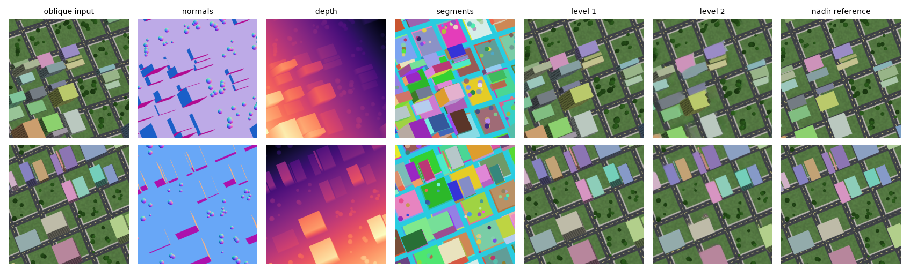
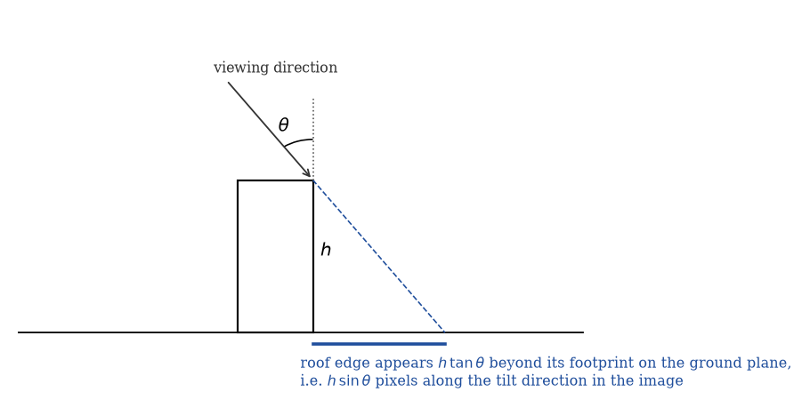
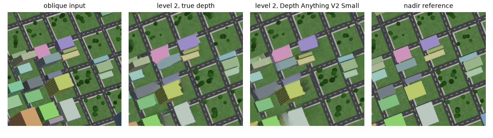

# locus-orthorectification

`locus-ortho` is a command-line tool that turns an oblique aerial image into a nadir (top-down) view, using only the image itself. It estimates the viewing tilt per image, corrects the ground plane, and moves roofs and tree crowns back over their footprints.

It was written for cross-view geo-localization, where models trained on nadir satellite tiles are tested on cities whose reference imagery is oblique.



*Two synthetic scenes with known geometry. Left to right: oblique input, surface normals, depth, segments, ground-plane rectification (level 1), relief correction (level 2), and the nadir rendering of the same scene.*

## Model

The camera is treated as orthographic, which holds for aerial and satellite imagery where the scene depth is small compared to the distance to the camera. Let θ be the angle between the viewing direction and the ground normal (θ = 0 is nadir), and let **t** be the image direction in which the ground recedes.

- **Ground plane.** Distances along **t** are foreshortened by cos θ. Stretching the image by 1 / cos θ along **t** restores the nadir ground plane.
- **Relief displacement.** A point at height *h* appears *h* sin θ pixels further along **t** than its footprint. On a vertical facade, the visible facade length below a roof edge equals the roof's displacement.



## Method

**Tilt and azimuth.** The azimuth **t** and a first tilt come from the dominant horizontal-surface normal of a normal map (vegetation excluded). In scenes with a street grid the tilt is then refined by metric rectification: lines on horizontal surfaces (streets, roof edges) are mostly at right angles in a nadir view, so the stretch *s* along **t** that makes them most orthogonal gives θ = arccos(1/*s*). Line segments are found with LSD [5] and scored by their four-fold alignment R(*s*) = |Σ *w* e<sup>4iφ</sup>| / Σ *w*. The line tilt is used only when there are at least 40 lines, the score is high (R ≥ 0.6), both orthogonal families are present (weight ratio ≥ 0.5), and R actually depends on *s* (max − min ≥ 0.1; a grid running along and across **t** is unchanged by any stretch). Otherwise the normal tilt is kept.

**Level 1.** Affine stretch by 1 / cos θ along **t** about the image centre.

**Level 2.** Applied when θ ≥ 8°. In a frame rotated so that **t** points up:

1. **Surfaces.** Facades are pixels whose normal is more than 55° from the ground normal or whose depth rises towards the camera faster than the ground does; vegetation (excess green) is never a facade. The remaining pixels are split into surfaces at segment boundaries, image edges and depth edges.
2. **Roofs.** Surfaces are visited from the bottom of the frame upwards. Below each column of a surface, the tool looks for a facade run. A surface with enough facade evidence is a roof, shifted by the median run length plus the shift of the surface the facade stands on. A surface that continues a neighbour at the same depth inherits its shift; one separated by a depth step is ground behind it.
3. **Heights from depth.** Depth above a fitted ground plane is converted to pixels with the ratio *shift / depth* measured on roofs with a visible facade. Raised surfaces without a visible facade get their shift from it.
4. **Trees.** Vegetation clusters at least 4 px above the ground are tree crowns. Each crown is moved back by its height and compressed by cos θ about its centre, so that the level-1 stretch leaves it round.
5. **Resampling.** Segments that mostly move are moved as one piece. Facades are removed, including those whose roof is outside the image. Surfaces are drawn at their footprints with higher ones last, the ground they hid is inpainted with LaMa [6], and the result is stretched by 1 / cos θ.

Inputs other than the image are computed by separate tools: normals with Marigold [2] (`scripts/normals.py`), segments with SAM [7] (`scripts/segments.py`), and depth with Depth Anything V2 [1], which the binary runs through ONNX Runtime unless a depth map is given.

## Installation

Building requires Rust 1.92 or newer. ONNX Runtime is downloaded by the `ort` crate at build time.

```bash
cargo build --release
mkdir -p models
curl -L -o models/depth_anything_v2_small.onnx \
  https://huggingface.co/onnx-community/depth-anything-v2-small/resolve/main/onnx/model.onnx
curl -L -o models/lama_fp32.onnx \
  https://huggingface.co/Carve/LaMa-ONNX/resolve/main/lama_fp32.onnx
```

Without the LaMa model, hidden ground is filled by smooth interpolation.

Normals and segments need Python with `torch`, `transformers`, `diffusers`, `accelerate` and `opencv-python-headless`:

```bash
python scripts/normals.py images/*.jpg --out normals/
python scripts/segments.py images/*.jpg --out segments/
```

## Usage

```bash
# level 2 (default)
target/release/locus-ortho images/*.jpg --normals normals/ --segments segments/ -o rectified/ --report report.json

# ground plane only
target/release/locus-ortho images/*.jpg --normals normals/ --level 1 -o rectified/

# known camera parameters
target/release/locus-ortho tile.jpg --tilt 30 --azimuth 0 --level 1
```

Each run prints one line per image:

```
tile.png  [lines]  tilt  33.9°  azimuth   -6.9°  roofs 63  trees 5  holes 0.171
```

| Option | Default | Meaning |
| --- | --- | --- |
| `-l, --level` | 2 | 1 = ground plane only, 2 = with relief correction |
| `--normals` | — | normal map file, or a directory of `<stem>.png` (required unless level 1 with `--tilt` and `--azimuth`) |
| `--segments` | — | segment label map file or directory; without it, surfaces are split at image and depth edges only |
| `--depth` | — | depth map (16-bit PNG, larger = closer) used instead of the model |
| `-m, --model` | `models/depth_anything_v2_small.onnx` | Depth Anything V2 ONNX model (also `LOCUS_ORTHO_MODEL`) |
| `--inpaint` | `models/lama_fp32.onnx` | LaMa ONNX model (also `LOCUS_ORTHO_INPAINT`) |
| `--tilt`, `--azimuth` | — | override the estimate; azimuth is clockwise from image up |
| `--report` | — | JSON with the tilt source, normal and line tilts, line score, balance and contrast, and level-2 counts per image |

Normal maps are 16-bit RGB PNGs with **n** = v / 65535 · 2 − 1 in camera coordinates (x right, y up, z towards the camera). Segment maps are 16-bit grayscale PNGs, 0 = no segment.

## Evaluation

### Synthetic scenes

`scripts/synthetic.py` renders city blocks with buildings and tree-filled parks under an orthographic camera with a random tilt (20–45°) and image rotation. For each scene it writes the oblique view, the nadir view with the same image orientation, and ground-truth depth, normals and segments. Normals are always the ground truth below. The table reports means over 8 scenes; SSIM is measured against the nadir view.

| Depth / segments | Tilt error (°) | Azimuth error (°) | SSIM input | SSIM level 1 | SSIM level 2 |
| --- | --- | --- | --- | --- | --- |
| true depth, true segments | 0.2 | 0.1 | 0.428 | 0.635 | 0.773 |
| true depth, no segments | 0.2 | 0.1 | 0.428 | 0.635 | 0.749 |
| Depth Anything V2 Small, true segments | 0.2 | 0.1 | 0.428 | 0.635 | 0.677 |

The tilt came from lines in four scenes and from normals in the other four, where the street grid runs along the tilt direction. Level 2 scored above level 1 in all eight scenes with true depth, and in six of eight with Depth Anything V2 Small. Segments help: without them, SSIM drops from 0.773 to 0.749. Per-scene values are in `docs/results_synthetic.json`.



```bash
python scripts/synthetic.py --out examples/synthetic --scenes 8
python scripts/evaluate_synthetic.py --scenes examples/synthetic
python scripts/figures.py --scenes examples/synthetic
```

### Real oblique imagery

The method was developed on CVG-Text [3] satellite tiles from Brisbane (near-nadir), New York and Tokyo (oblique). The tiles are not reproduced here because of the imagery license.

An earlier version, which took the tilt from normals only and had a simpler level 2, was tested for ground-to-aerial retrieval: 200 test pairs per city (seed 0) served as both query set and gallery, and each tile was rectified before retrieval with models trained on nadir CVUSA tiles. Values are R@1 (%), input / level 1.

| Model | Brisbane | New York | Tokyo |
| --- | --- | --- | --- |
| Sample4Geo [4] CVUSA weights, no training | 98.0 / 98.0 | 47.0 / 48.5 | 65.0 / **72.0** |
| RGB, seed 0 | 97.0 / 96.5 | 39.0 / **43.5** | 63.5 / 65.0 |
| RGB, seed 1 | 96.5 / 96.5 | 42.5 / 45.0 | 62.5 / 63.5 |
| RGB + depth, seed 0 | 96.0 / 96.5 | 44.5 / 41.5 | 62.0 / 61.5 |
| RGB + depth, seed 1 | 95.5 / 95.5 | 44.5 / 44.0 | 60.5 / 64.5 |

The RGB and RGB + depth models are ConvNeXt-B models initialized from Sample4Geo CVACT weights and trained for 4 epochs on CVUSA, the latter with a panorama-depth branch. Bold values differ from the input at p < 0.05 (exact McNemar test on per-query R@1: p = 0.001 for Tokyo, p = 0.049 for New York). That earlier level 2 never scored above level 1. The current level 2 and the line-based tilt have not yet been tested for retrieval.

## Limitations

- **Normals are needed.** The tilt from depth alone was unreliable on real imagery and has been removed. On 600 CVG-Text tiles it differed from the normal-based tilt by 9.7–19.0° on average.
- **The line tilt needs a grid.** On curved streets or with lines in one direction only, the normal tilt is used. Its thresholds were chosen on seven real tiles and the synthetic scenes.
- **Single view.** Ground hidden behind buildings is not observed; it is inpainted. Facades that are not recognized as facades (for example curved glass) stay in the image and are stretched like ground.
- **Depth quality.** Heights of raised surfaces without a visible facade, and of trees, come from monocular depth and inherit its errors.
- **Not handled.** Cars, street furniture and other small objects are treated as ground. Strongly sloped terrain and perspective effects of wide-angle imagery are not modelled.

## Third-party models

| Model | Used for | License |
| --- | --- | --- |
| Depth Anything V2 Small ([ONNX](https://huggingface.co/onnx-community/depth-anything-v2-small)) | depth | Apache-2.0 |
| LaMa ([ONNX](https://huggingface.co/Carve/LaMa-ONNX)) | inpainting | Apache-2.0 |
| Marigold Normals v1-1 ([model card](https://huggingface.co/prs-eth/marigold-normals-v1-1)) | normals (`scripts/normals.py`) | OpenRAIL++ |
| SAM ViT-B ([model card](https://huggingface.co/facebook/sam-vit-base)) | segments (`scripts/segments.py`) | Apache-2.0 |

Line segments are detected with the [`lsdetect`](https://crates.io/crates/lsdetect) crate (MIT or Apache-2.0).

## References

- [1] L. Yang et al. *Depth Anything V2.* NeurIPS 2024.
- [2] B. Ke et al. *Repurposing Diffusion-Based Image Generators for Monocular Depth Estimation* (Marigold). CVPR 2024; Marigold v1-1 normals.
- [3] J. Ye et al. *Where am I? Cross-View Geo-localization with Natural Language Descriptions* (CVG-Text). ICCV 2025.
- [4] F. Deuser, K. Habel, N. Oswald. *Sample4Geo: Hard Negative Sampling For Cross-View Geo-Localisation.* ICCV 2023.
- [5] R. Grompone von Gioi, J. Jakubowicz, J.-M. Morel, G. Randall. *LSD: a Line Segment Detector.* Image Processing On Line, 2012.
- [6] R. Suvorov et al. *Resolution-robust Large Mask Inpainting with Fourier Convolutions* (LaMa). WACV 2022.
- [7] A. Kirillov et al. *Segment Anything.* ICCV 2023.
